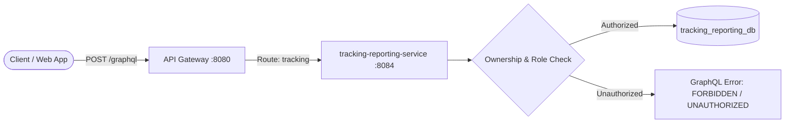

# Zentro GraphQL Read-Only Tracking & Reporting API (ZD-073)

## 1. Overview & Architecture

The Zentro GraphQL API provides a strictly read-only, high-performance query interface for parcel tracking and delivery status history.

- **Endpoint**: `/graphql`
- **HTTP Methods**: `POST` (standard queries), `GET` (schema/query inspection)
- **Target Microservice**: `tracking-reporting-service` (S4, port 8084)
- **Routing**: API Gateway (`api-gateway`, port 8080) routes `/graphql` to S4 while enforcing non-service-only token access and forwarding requests to backend security filters.
- **Architectural Scope**: Strictly Read-Only (`Query` root only). No mutations or subscriptions are exposed.



---

## 2. Strictly Read-Only Contract

The GraphQL schema defines **only** the `type Query` root operation. Any attempt to execute a mutation is rejected at schema validation time before data fetchers or backend business logic execute.

```graphql
# Attempting a mutation will fail validation:
mutation CancelDelivery {
  cancelDelivery(trackingRef: "ZT-7K3QX9M2PA") {
    trackingRef
  }
}

# Response:
{
  "errors": [
    {
      "message": "Validation error of type FieldUndefined: Field 'cancelDelivery' in type 'Mutation' is undefined",
      "locations": [{"line": 2, "column": 3}],
      "extensions": {"classification": "ValidationError"}
    }
  ]
}
```

---

## 3. Public vs. Authenticated Information Disclosure Rules

Zentro enforces strict privacy boundaries between public tracking queries and authenticated resource-owner queries:

| Field | `publicTracking` (Public) | `delivery` (Authenticated Owner) | Reason |
|---|:---:|:---:|---|
| `trackingRef` | Yes | Yes | Public parcel lookup reference |
| `status` / `rawStatus` | Yes | Yes | Operational lifecycle status |
| `originCity` / `destinationCity` | Yes | Yes | General geographic milestone info |
| `category` / `size` / `description` | Yes | Yes | Non-sensitive package details |
| `estimatedDays` / `estimatedDeliveryDate` | Yes | Yes | Non-sensitive delivery estimates |
| `createdAt` / `deliveredAt` / `failureReason` | Yes | Yes | Non-sensitive status milestones |
| `events` (timeline events) | Yes | Yes | Status history without PII |
| **`sender.name` / `sender.phone` / `sender.address`** | **EXCLUDED** | **Yes** | **Customer PII protection** |
| **`recipient.name` / `recipient.phone` / `recipient.address`** | **EXCLUDED** | **Yes** | **Recipient PII protection** |
| **`fee` / `currency` / `formattedFee`** | **EXCLUDED** | **Yes** | **Commercial pricing privacy** |
| **`customerSubject` / `merchantSubject` / `courierSubject`** | **EXCLUDED** | **EXCLUDED** | **Internal security identities** |

---

## 4. Role Matrix and Resource Ownership

Authentication requires a standard Bearer JWT token issued by Keycloak. User identity and roles are derived directly from the verified security context (`extractSubject(authentication)`). Client-supplied identities are never trusted.

| Role | `publicTracking` | `delivery` | `myDeliveries` | `deliveries` | Ownership Rule |
|---|:---:|:---:|:---:|:---:|---|
| **Anonymous / Public** | Allowed | Denied (401) | Denied (401) | Denied (401) | No PII access permitted |
| **ROLE_CUSTOMER** | Allowed | Owned only | Owned only | Denied (403) | `parcel.customerSubject == jwt.sub` |
| **ROLE_MERCHANT** | Allowed | Owned only | Owned only | Denied (403) | `parcel.merchantSubject == jwt.sub` |
| **ROLE_COURIER** | Allowed | Assigned only | Assigned only | Denied (403) | `parcel.courierSubject == jwt.sub` |
| **ROLE_DISPATCHER** | Allowed | All | All | All | Platform-wide operational monitoring |
| **ROLE_SERVICE** | Denied (403) | Denied (403) | Denied (403) | Denied (403) | Service tokens blocked from human GraphQL API |

---

## 5. N+1 Query Prevention (Batch Mapping)

Relationship queries (e.g. requesting `events` for a list of deliveries in `myDeliveries` or `deliveries`) are resolved using `@BatchMapping`:

```java
@BatchMapping(typeName = "DeliveryDetails", field = "events")
public Map<DeliveryDetailsDto, List<TrackingEventDto>> events(List<DeliveryDetailsDto> deliveries) {
  List<String> refs = deliveries.stream().map(DeliveryDetailsDto::trackingRef).distinct().toList();
  List<TrackingEvent> events = eventRepository.findByTrackingRefInOrderByOccurredAtAsc(refs);
  ...
}
```

This guarantees that fetching events across `N` parcels executes **exactly 1 SQL query** (`WHERE tracking_ref IN (...)`) regardless of page size.

---

## 6. Query Protection & Limits

To defend against Denial-of-Service (DoS) and expensive nested graph traversals, the GraphQL engine applies strict limits:

1. **Maximum Query Depth: 7**
   - Configured via `MaxQueryDepthInstrumentation(7)`.
   - Queries with nesting depth exceeding 7 (including nested introspection trees) are rejected immediately.
2. **Maximum Query Complexity: 100**
   - Configured via `MaxQueryComplexityInstrumentation(100)`.
   - Factors in connection size arguments (`size`) to dynamically assess batch load.
3. **Pagination Safeguards**:
   - `page`: 1-indexed, minimum value `1` (negative or `0` rejected with `BAD_REQUEST`).
   - `size`: default `10`, minimum value `1` (negative or `0` rejected with `BAD_REQUEST`).
   - Maximum allowed `size`: capped at `50` items per request.

---

## 7. Schema Definition

```graphql
enum TrackingStatus {
  CREATED
  PICKED_UP
  IN_TRANSIT
  OUT_FOR_DELIVERY
  DELIVERED
  FAILED
}

type Party {
  name: String!
  phone: String!
  address: String!
  city: String
}

type TrackingEvent {
  id: ID!
  trackingRef: String!
  status: String!
  title: String
  description: String
  actorRole: String
  location: String
  occurredAt: String!
  failureReason: String
}

type PublicTrackingParcel {
  trackingRef: String!
  status: TrackingStatus!
  rawStatus: String!
  category: String!
  size: String
  description: String
  originCity: String
  destinationCity: String
  estimatedDays: Int!
  estimatedDeliveryDate: String
  createdAt: String!
  deliveredAt: String
  failureReason: String
  events: [TrackingEvent!]!
}

type DeliveryDetails {
  id: ID!
  trackingRef: String!
  status: TrackingStatus!
  rawStatus: String!
  category: String!
  size: String
  description: String
  destinationType: String
  isExpress: Boolean!
  sender: Party!
  recipient: Party!
  fee: Float!
  currency: String!
  formattedFee: String
  estimatedDays: Int!
  createdAt: String!
  deliveredAt: String
  failureReason: String
  events: [TrackingEvent!]!
}

type PageInfo {
  page: Int!
  size: Int!
  totalElements: Int!
  totalPages: Int!
  hasNext: Boolean!
  hasPrevious: Boolean!
}

type DeliveryConnection {
  items: [DeliveryDetails!]!
  pageInfo: PageInfo!
}

type Query {
  publicTracking(trackingRef: String!): PublicTrackingParcel
  delivery(trackingRef: String!): DeliveryDetails
  myDeliveries(page: Int = 1, size: Int = 10, status: TrackingStatus, query: String): DeliveryConnection!
  deliveries(page: Int = 1, size: Int = 10, status: TrackingStatus, query: String): DeliveryConnection!
}
```

---

## 8. Example Queries

### Public Tracking Query
```graphql
query GetPublicStatus {
  publicTracking(trackingRef: "ZT-7K3QX9M2PA") {
    trackingRef
    status
    originCity
    destinationCity
    estimatedDays
    estimatedDeliveryDate
    events {
      status
      title
      occurredAt
    }
  }
}
```

### Authenticated Single Delivery Query (Owner / Dispatcher)
```graphql
query GetDeliveryDetails {
  delivery(trackingRef: "ZT-7K3QX9M2PA") {
    trackingRef
    status
    sender {
      name
      phone
      address
    }
    recipient {
      name
      phone
      address
    }
    fee
    currency
    events {
      status
      title
      location
      occurredAt
    }
  }
}
```

### Paginated Deliveries Query (Caller Scope)
```graphql
query GetMyDeliveries {
  myDeliveries(page: 1, size: 20, status: IN_TRANSIT, query: "Kandy") {
    items {
      trackingRef
      status
      recipient {
        name
        city
      }
      events {
        status
        title
      }
    }
    pageInfo {
      page
      size
      totalElements
      totalPages
      hasNext
    }
  }
}
```

