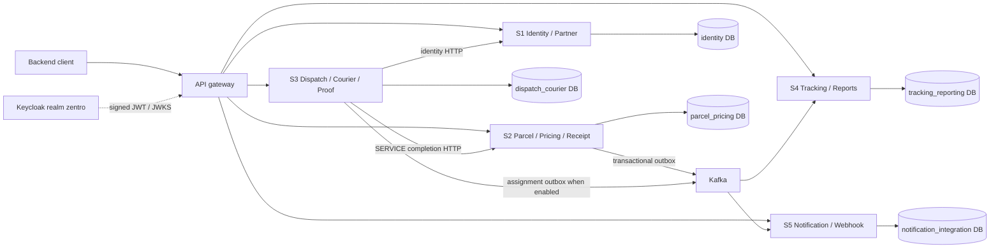
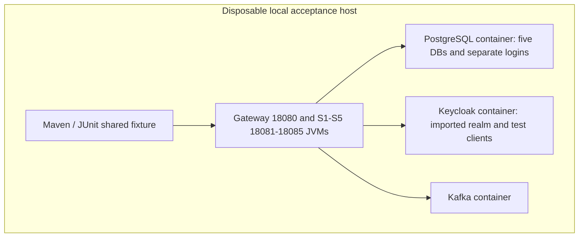
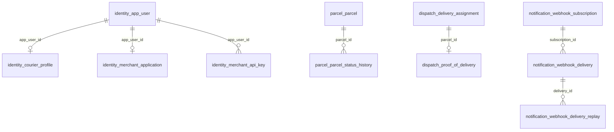

# Backend technical completion appendix — Issue #359

Status: PARTIAL. This describes repository implementation at base `1f1b766` and
Main 10 acceptance additions. It is not a deployed-topology or release approval.

## Service and deployment architecture

Candidate enumeration/claim integration is missing; no successful S2→S3 candidate
arrow is claimed. S2 owns lifecycle/history writes; S3 successful proof completion
uses restricted SERVICE credentials. Gateway and each service validate tokens
independently. Kubernetes/Helm placeholders are not deployment evidence.

Ports bind loopback. Processes run from E2E `target`, not personal service working
directories. Host JVMs use packaged JARs; a single physical DB container does not
permit runtime cross-service SQL. Fixture read-only SQL verifies owning source facts.

## Physical relationship summary

The following relationships reflect Flyway migrations, not cross-service joins.
Tracking event rows are related by application parcel keys; no external database FK
is implied. Receipt objects/PDFs are generated from persisted booking/order facts,
not a new receipt table.

Service-local outbox, assignment audit, processed-event and delivery projection
tables are additional independent facts. Verify full columns in
`backend/*/src/main/resources/db/migration`; never modify applied migrations.

## Contracts, security and contribution evidence

- [API inventory](../api/README.md), [OpenAPI artifacts](../api/openapi/),
  [parcel event contract](../api/parcel-events.md), [projection contract](../events/projections.md).
- [Role/permission inventory](../security/authorization-matrix.md),
  [final security acceptance](../security/backend-final-signoff.md),
  [production configuration](../security/production-configuration.md).
- [Operations](../operations/backend-runbook.md), [handover](../operations/backend-handover.md),
  [candidate evidence](../testing/backend-integration-evidence.md).

Authoritative contribution evidence is the actual GitHub PR and commit history.
PR #369 documents Main 05 assignment/proof changes; #365 S2 retrieval; #377
tracking/receipt changes; #378 report API changes. This appendix does not attribute
unverified personal effort, hours or authorship. Main 10 additions in this branch
are shared acceptance support, generic role/integration tests, evidence tooling,
owner requests and this backend documentation. Domain production remains unchanged.

Coverage percentages are UNVERIFIED here. Test counts and skips come from current
JUnit reports, not a coverage percentage estimate. Final deliverable requirements,
deployment facts and independent contribution/document sign-off remain UNVERIFIED;
no final project PDF or frontend deliverable is produced.

## Verified backend deliverable requirements

Historical issue bodies #185/#263/#265/#266/#267/#268/#271 were read again on
2026-11-14; all were open. They are evidence references, not parallel ownership
assignments. Main 10 assembles only the backend subset under authoritative #359.

| Historical reference | Required backend artifact | Current artifact / remaining acceptance |
|---|---|---|
| #185 | Completion status and handover with actual tests/limitations | Candidate index and backend handover exist; final acceptance/review/merge remain BLOCKED. |
| #263 | Architecture, ER and deployment diagrams matching implementation/topology | Diagrams above cover repository and disposable topology. Production topology approval and owner review remain UNVERIFIED. |
| #265 | Final design PDF compiled from approved diagrams/contracts | Backend Markdown design appendix exists. Approved source-diagram pack and explicit backend-only PDF deliverable scope are not recorded; PDF assembly remains BLOCKED. No final project PDF is generated. |
| #266 | Test report, coverage artifacts, failures and limitations | Current sanitized reports/index plus historical reports; cross-service acceptance and final CI incomplete. No fabricated all-module coverage percentage. |
| #267 | Contribution sheet from assigned issues and real merged PRs | Verified PR-author/merge facts below; per-member final contribution review remains UNVERIFIED. No effort/hour/share estimate. |
| #268 | Report chapters, figures and appendices reconciled with implementation | Backend runbook/security/design/test appendices assembled; overall project/frontend chapters excluded. Owner document review remains UNVERIFIED. |
| #271 | Accepted issues, merged PRs, release SHA, checks and outstanding limitations | Single backend evidence index exists. No accepted release SHA or completion claim while release is BLOCKED. |

Verified GitHub PR metadata (read 2026-11-14):

| PR | Recorded PR author | Actual merge SHA | Demonstrated contribution scope |
|---|---|---|---|
| [#365](https://github.com/pirathee587/Zentro/pull/365) | @Jathuja | `5a3aba3928620d8a671d6e4b213b18c2d4acf6d6` | Owner-scoped parcel retrieval and deterministic order sorting. |
| [#369](https://github.com/pirathee587/Zentro/pull/369) | @Nilakshana23 | `72408ff31d8278fe47266fcbfdacc5d7adc6f31a` | Assignment safety and proof validation; retained lifecycle/source/policy blockers. |
| [#377](https://github.com/pirathee587/Zentro/pull/377) | @hephzibah-peries | `ea3c4a1dfea4535a899d3866f51142ad72d4ad0b` | Tracking projections, receipts and privacy; merge is not full live hydration acceptance. |
| [#378](https://github.com/pirathee587/Zentro/pull/378) | @14Jannan | `1f1b766d00f18c8eae788a1f399b34fb88e1bb0c` | Dispatcher reports API and filter acceptance; final whole-system sign-off separate. |

These are PR authorship/merge facts, not a claim that one author performed every
line, that the entire service is finished, or that the PR proves this candidate.
Main 10's own acceptance work remains in an unmerged review branch and must not
be counted as a merged contribution or independent approval.
