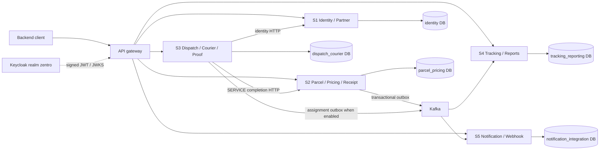
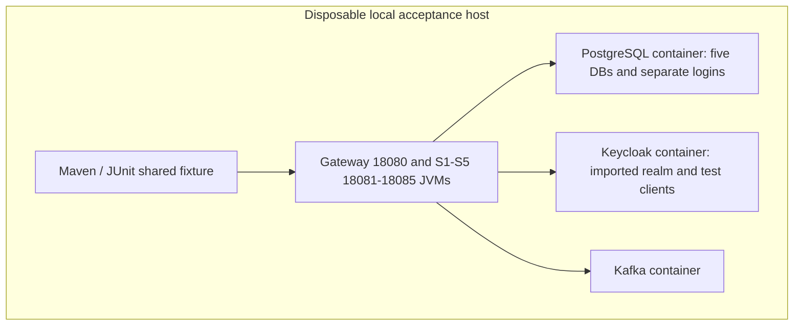
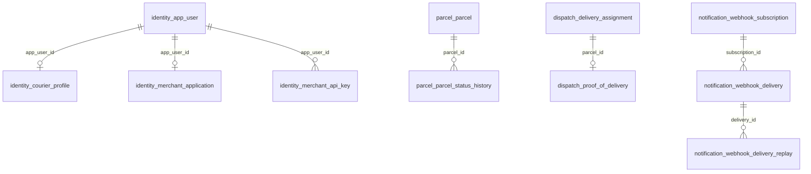

# Backend technical completion appendix — Issue #359

Status: PARTIAL. This describes repository implementation at base `1f1b766` and
Main 10 acceptance additions. It is not a deployed-topology or release approval.

## Service and deployment architecture

Candidate enumeration/claim integration is missing; no successful S2→S3 candidate
arrow is claimed. S2 owns lifecycle/history writes; S3 successful proof completion
uses restricted SERVICE credentials. Gateway and each service validate tokens
independently. Kubernetes/Helm placeholders are not deployment evidence.

Ports bind loopback. Processes run from E2E `target`, not personal service working
directories. Host JVMs use packaged JARs; a single physical DB container does not
permit runtime cross-service SQL. Fixture read-only SQL verifies owning source facts.

## Physical relationship summary

The following relationships reflect Flyway migrations, not cross-service joins.
Tracking event rows are related by application parcel keys; no external database FK
is implied. Receipt objects/PDFs are generated from persisted booking/order facts,
not a new receipt table.

Service-local outbox, assignment audit, processed-event and delivery projection
tables are additional independent facts. Verify full columns in
`backend/*/src/main/resources/db/migration`; never modify applied migrations.

## Contracts, security and contribution evidence

- [API inventory](../api/README.md), [OpenAPI artifacts](../api/openapi/),
  [parcel event contract](../api/parcel-events.md), [projection contract](../events/projections.md).
- [Role/permission inventory](../security/authorization-matrix.md),
  [final security acceptance](../security/backend-final-signoff.md),
  [production configuration](../security/production-configuration.md).
- [Operations](../operations/backend-runbook.md), [handover](../operations/backend-handover.md),
  [candidate evidence](../testing/backend-integration-evidence.md).

Authoritative contribution evidence is the actual GitHub PR and commit history.
PR #369 documents Main 05 assignment/proof changes; #365 S2 retrieval; #377
tracking/receipt changes; #378 report API changes. This appendix does not attribute
unverified personal effort, hours or authorship. Main 10 additions in this branch
are shared acceptance support, generic role/integration tests, evidence tooling,
owner requests and this backend documentation. Domain production remains unchanged.

Coverage percentages are UNVERIFIED here. Test counts and skips come from current
JUnit reports, not a coverage percentage estimate. Final deliverable requirements,
deployment facts and independent contribution/document sign-off remain UNVERIFIED;
no final project PDF or frontend deliverable is produced.
