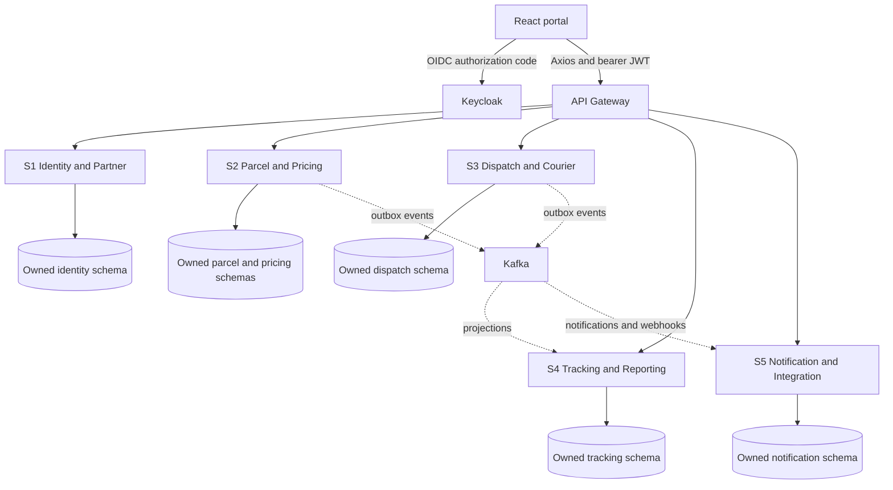
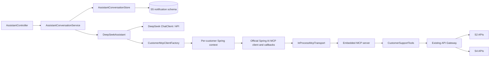
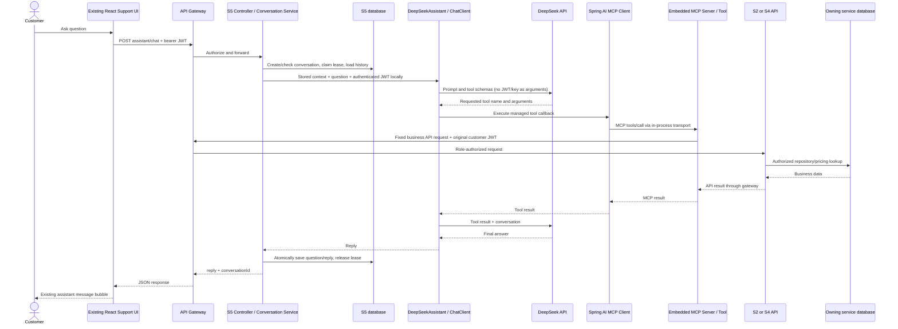

# Current Zentro architecture and customer chat flow

## Verified runtime status

This audit inspected WARP.md, source instructions, S5 code, gateway routes, frontend API/auth code,
service persistence code and V6 migrations. No nested WARP/AGENTS instructions were found.

- Gateway, S1, S2, S3, S4 and S5 returned HTTP 200 / health UP; Keycloak discovery returned 200.
- Unauthenticated requests to gateway chat history, direct S5 history and gateway tracking/mine returned 401.
- The running S5 `/app/app.jar` did not contain AssistantController, CustomerMcpClientFactory or V6 assistant migration.
  Therefore the deployed S5 artifact does not match the implemented source.
- The saved S5 `.env` and running S5 container did not have a nonempty DEEPSEEK_API_KEY at the last check.
  IDE text supplied in chat contains an assignment, but it was not present in the file read from disk.
- A live DeepSeek call was not made without a saved key. No live customer-authenticated database lookup was claimed.
- Current source verification passed 28 targeted assistant/MCP/PostgreSQL/JWT/gateway tests, with no failures.
  Provider/business HTTP responses in orchestration tests are stubs; PostgreSQL persistence tests use a real disposable container.

## Overall implemented architecture

This diagram describes code pathways. Health checks alone do not verify all pathways, and dashed Kafka
flows require publishers/consumers to be enabled and functioning.



Each service has its own datasource configuration and owns its persistence boundaries. The source uses
schemas; this diagram does not assert five physically independent PostgreSQL servers/databases.
S1 manages identities/partners alongside Keycloak authentication. S2 books parcels and calculates prices.
S3 coordinates dispatch/courier workflows. S4 serves tracking, histories, reporting and live updates.
S5 owns notification/webhook integrations and the customer assistant. Keycloak issues tokens; services
independently validate them. The gateway is the frontend's backend entry point.

## S5 assistant internals



All these components remain inside S5. There is no separate chat/MCP deployable or exposed MCP listener.
The official Spring AI 1.0.3 client auto-configurations create/initialize the client and callback provider
in a private Spring context. Global client creation is disabled; each customer context enables the official
configuration. The SDK is a transitive implementation dependency, not a second application client path.
The context and transport close after each invocation. Tools capture the authenticated JWT locally.

`AssistantController` handles HTTP validation/security and delegation. `AssistantConversationService`
coordinates leases, history, AI invocation and saved turns. `DeepSeekAssistant` handles the system prompt,
provider requests and bounded model/tool rounds. The factory/session manage the official MCP lifecycle;
the transport exchanges MCP messages. `CustomerSupportTools` validates arguments and calls fixed business
API paths. `AssistantConversationStore` handles only S5 conversation persistence. DTOs and configuration
have their own responsibility packages.

## Implemented request sequence

This is the source's successful path, not a claim that the currently running old S5 artifact completed it.



DeepSeek does not execute MCP itself: the Java application executes its requested calls. Tools route back
through the gateway, not directly across databases. For tracking, a tool first checks ownership with S4
`tracking/mine` before reading the public tracking view.

## Exact tools and API mapping

All paths below are reached through the existing gateway with the original customer JWT.

| MCP tool | Existing API | Owner |
|---|---|---|
| get_parcel_details | GET /api/v1/parcels/{parcel UUID} | S2 |
| get_parcel_status | Same S2 parcel endpoint | S2 |
| get_parcel_information | Same S2 parcel endpoint | S2 |
| get_tracking_history | GET /api/v1/tracking/mine?q={ref}&size=100, then GET /api/v1/tracking/{ref} | S4 |
| get_current_tracking_status | Same owner check and tracking view | S4 |
| get_estimated_delivery | Same owner check and tracking view | S4 |
| get_my_deliveries | GET /api/v1/tracking/mine?size=10 | S4 |
| calculate_delivery_fee | POST /api/v1/parcels/estimate with pickupCity, deliveryCity, weightKg | S2 |

Parcel aliases currently return the same selected fields. Tracking aliases return the same full tracking
view, including timeline/events and estimates; they are not separate dedicated business APIs.
`get_my_deliveries` returns a selected summary of the latest ten rows, not all pages.

| Customer question | Available processing path |
|---|---|
| Where is my parcel? | get_my_deliveries to identify it; ask for a reference if ambiguous; get_current_tracking_status for a known owned reference |
| What is my parcel's current status? | get_parcel_status for a known UUID, or get_current_tracking_status for a tracking reference |
| Show my parcel tracking history | get_tracking_history after obtaining the reference and checking ownership |
| How much does delivery cost? | Ask for pickup/destination city and weight, then calculate_delivery_fee |
| Show my deliveries | get_my_deliveries |

These are available paths. DeepSeek chooses tools at runtime; natural-language questions do not map to
one guaranteed hardcoded tool. The existing “Price for 2 kg to Kandy” chip is missing pickup city, so the
assistant should ask for it. It must not invent a price or calculate one in React.

## JWT workflow

React uses the existing Keycloak OIDC authorization-code flow. AuthProvider supplies the access token to
the shared Axios client, whose interceptor adds Authorization: Bearer. Gateway and S5 validate signatures,
issuer, audience and expiry through the existing security configuration. S5 requires CUSTOMER and rejects
DISPATCHER/SERVICE mixed privileges for this assistant. The subject comes from the validated Jwt principal.
Conversation ownership is always scoped by that subject; a foreign/missing conversation returns 404.

The MCP tools capture the customer JWT outside model arguments and forward it to fixed gateway APIs.
S2 calls `getByIdAndOwner`, backed by a customer-scoped repository query. S4's list queries are subject-scoped
(with its existing customer/merchant fallback); the tracking tool requires an exact owned reference match
before public tracking lookup. The LLM cannot select customer IDs, arbitrary URLs or credentials as tool
arguments. Credentials must never be part of prompts or user-visible responses; they belong only in the
backend provider request and authenticated business transport.

## Conversation persistence

V6 creates `notification.assistant_conversation` and `notification.assistant_message` in the existing S5
schema. A missing conversationId creates a UUID associated with the validated JWT subject. Before a reply,
an atomic update claims a two-minute lease; overlapping turns return 409. Up to 100 latest saved messages
are available via history; the latest 20 become model context. Supplied legacy client history is validated
but not trusted as persisted context. No database transaction remains open during provider HTTP requests.

A completed question/reply pair, including a safe provider fallback if returned, is saved atomically and
the lease released. Unexpected failures release the lease in finally; a killed process's lease expires.
Database history survives application restarts. The React conversation ID exists in a component ref, so
page reload loses the active selection and starts a new conversation. History APIs exist, but the UI does
not automatically restore a conversation or offer a history selector.

## Status and limitations

Implemented in source: chat endpoints, real-provider adapter, official managed MCP client, embedded server,
S2/S4 tool adapters, conversation persistence, validation, JWT forwarding, ownership checks and existing UI
wiring. Frontend production normally uses the real assistant unless VITE_USE_ASSISTANT_MOCK=true.

Not verified live: a complete browser/customer-session/provider/tool/database response cycle. The key was
absent from saved configuration and the running S5 artifact is older than the implementation. A valid
customer login/session is also required for private-data checks; no authentication was bypassed.

Additional limitations:

- S4 customer-owned deliveries require populated ownership fields. S2's current parcel.created event omits
  customer identity, and its consumer does not derive it. Ordinary event processing alone therefore does
  not prove a new S2 booking becomes visible in `/tracking/mine`.
- Publisher/consumer enable flags were absent in the inspected running container environments; source
  defaults are disabled. Healthy service processes do not prove active event projection.
- No customer-authorized courier-profile/notification-history/send tools are implemented.
- Contact-us submission still uses mockCustomerAdapter.sendSupportMessage. The screenshot's FAQ text is
  static UI copy, not a live pricing/policy query.
- Provider limits are three model rounds, six tool calls, default 15-second reads and a 70-second round
  budget; gateway/frontend timeouts are 90 seconds. Provider failures return safe fallbacks.

## Required local runtime steps

Save a replacement DeepSeek key in S5's actual `.env` file. Keep keys/passwords out of chat and source control.
After configuration is saved, rebuilding/recreating is necessary to use the new source and environment:

```bash
docker compose up -d --build --no-deps api-gateway notification-integration-service
```

This audit did not recreate the application containers or change live database data. After recreation,
confirm the V6 migration succeeds, sign in as an existing customer, and compare a chat result with the
same authenticated S2/S4 endpoint result for a parcel owned by that customer. That comparison is required
to establish live database-backed behavior; stub tests are not a substitute.
