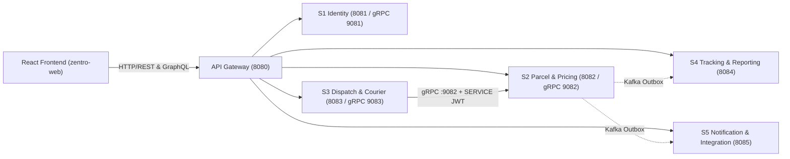
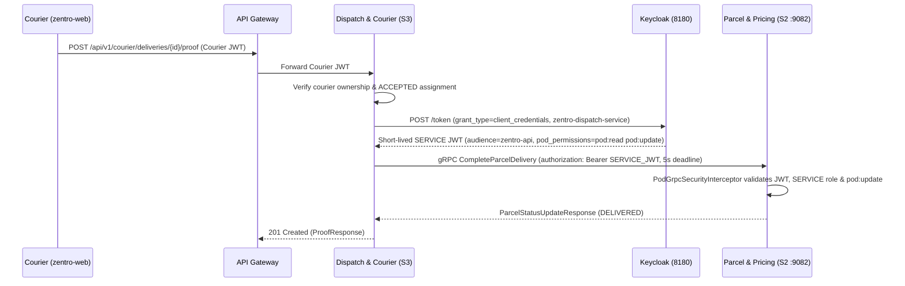

# Zentro — Project-Wide gRPC Microservice Communication Standard

## 1. Core Communication Rules
- **Internal Synchronous Communication**: Must use **gRPC** with Protocol Buffers (`contracts/proto/`).
- **Frontend-to-Backend**: React (`zentro-web`) → HTTP/REST/GraphQL → `api-gateway` (`8080`).
- **Asynchronous Messaging**: **Apache Kafka** remains the event bus (`parcel.created`, `parcel.status.updated`, `delivery.assigned`, `delivery.accepted`, `delivery.rejected`).
- **External HTTP Integrations**: Approved external APIs (`DeepSeekAssistant`, Keycloak OAuth2 token endpoint) continue using HTTP/REST.
- **No New Internal REST Clients**: Enforced in CI by `ArchitectureGrpcComplianceTest` (`backend/libs/zentro-security-starter`).

---

## 2. Service Dependency & Communication Inventory

| Caller | Receiver | Current Protocol | Target Protocol | Business Purpose | Auth Mechanism |
|---|---|---|---|---|---|
| S3 (`dispatch-courier-service`) | S2 (`parcel-pricing-service`) | **gRPC** (`9082`) | **gRPC** (`9082`) | `GetParcel` status check for assignment, POD completion (`CompleteParcelDelivery`) & courier status (`UpdateCourierParcelStatus`) | Keycloak `SERVICE` JWT (`zentro-dispatch-service`, `pod:read` for GetParcel; `pod:update` for mutations) |
| S1 (`identity-partner-service`) | — | **gRPC Server** (`9081`) | **gRPC Server** (`9081`) | `GetMerchantStatus`, `GetCourierProfile`, `ListCouriers`, `GetCourierById`, `GetCourierByUserSubject`, `VerifyMerchantAccount` | `SERVICE` / `DISPATCHER` JWT or `x-internal-token` |
| S3 (`dispatch-courier-service`) | S1 (`identity-partner-service`) | **gRPC** (`9081`) | **gRPC** (`9081`) | Courier profile & eligibility lookup (`IdentityCourierClient` → `IdentityPartnerGrpcClient`) | Keycloak `SERVICE` JWT (`zentro-dispatch-service`) |
| S2 (`parcel-pricing-service`) | S1 (`identity-partner-service`) | **gRPC** (`9081`) | **gRPC** (`9081`) | Merchant approval & account verification (`IdentityMerchantClient` → `IdentityPartnerGrpcClient`) | Keycloak `SERVICE` JWT (`zentro-parcel-service`) |
| S5 (`notification-integration-service`) | S1 (`identity-partner-service`) | **gRPC** (`9081`) | **gRPC** (`9081`) | Merchant approval verification for webhooks (`IdentityMerchantClient` → `IdentityPartnerGrpcClient`) | Keycloak `SERVICE` JWT (`zentro-notification-service`) |
| S4 (`tracking-reporting-service`) | S2 (`parcel-pricing-service`) | **gRPC** (`9082`) | **gRPC** (`9082`) | Customer dashboard summary, parcel queries, history, public tracking & fee quotation (`CustomerBookingClient`, `DashboardPricingClient`) | Keycloak `SERVICE` JWT (`zentro-tracking-service`) |
| S4 (`tracking-reporting-service`) | S3 (`dispatch-courier-service`) | **gRPC** (`9083`) | **gRPC** (`9083`) | Customer delivery courier assignment summary (`GetParcelAssignmentSummary`) | Keycloak `SERVICE` JWT (`zentro-tracking-service`) |
| S5 (`notification-integration-service`) | S2 (`parcel-pricing-service`) | **gRPC** (`9082`) | **gRPC** (`9082`) | Customer support MCP tools (`CustomerSupportTools` → `ParcelPricingGrpcClient`) | Keycloak `SERVICE` JWT (`zentro-notification-service`) |
| S2 / S3 → S4 / S5 | Kafka | **Kafka** | **Kafka** | Async outbox event publishing & projections | Kafka SASL/TLS |
| S5 (`DeepSeekAssistant`) | DeepSeek API | **HTTPS REST** | **HTTPS REST** | External AI assistant | API Key |

---

## 3. Architecture & POD Sequence Diagrams

---

## 4. Service Ports, Contracts & Shared Security Infrastructure
- **Contracts (`contracts/proto/`)**:
  - `identity_partner.proto` (`zentro.identity.v1.IdentityPartnerService`, S1 port `9081`)
  - `parcel_pricing.proto` (`zentro.parcel.v1.ParcelPricingService`, S2 port `9082`)
  - `dispatch_courier.proto` (`zentro.dispatch.v1.DispatchCourierService`, S3 port `9083`)
- **Shared Starter (`zentro-security-starter`)**:
  - `GrpcServiceTokenProvider`: In-memory cached OAuth2 `client_credentials` token provider with 30s pre-expiry refresh.
  - `BearerServiceGrpcClientInterceptor`: Attaches `authorization: Bearer <jwt>` to outgoing gRPC metadata.
  - `ArchitectureGrpcComplianceTest`: Fails CI if any new unapproved `RestClient`, `RestTemplate`, or `WebClient` appears in `backend/*/src/main/java`.
- **Deadlines & Retries**: All outbound gRPC calls enforce explicit deadlines (default `5s`); non-idempotent state mutations are never blindly retried.
- **Production TLS**: Internal gRPC channels must use TLS (`useTransportSecurity()`) in production profiles; plaintext is restricted to local Docker bridge networks.

## 5. Implemented Service Surface and Docker Configuration

| Service | HTTP ingress | gRPC server | Outbound gRPC | SERVICE client identity |
|---|---:|---:|---|---|
| S1 Identity & Partner | 8081 | 9081 | None in this migration | Server validates caller JWTs |
| S2 Parcel & Pricing | 8082 | 9082 | S1 on 9081 | `zentro-parcel-service` |
| S3 Dispatch & Courier | 8083 | 9083 | S1 on 9081; S2 on 9082 | `zentro-dispatch-service`; POD methods require its scoped POD permissions |
| S4 Tracking & Reporting | 8084 | None | S2 on 9082; S3 on 9083 | `zentro-tracking-service` |
| S5 Notification & Integration | 8085 | None | S1 on 9081; S2 on 9082 | `zentro-notification-service` |

S4/S5 are gRPC clients, not gRPC servers, so they have no gRPC listening ports. Docker Compose keeps backend services on `zentro-backend` and joins services that need token/JWKS access to `keycloak_default`. Keycloak publishes the canonical development issuer `http://localhost:8180/realms/zentro`; backend containers use `keycloak:8080` for token and JWKS network requests, so they do not call localhost to reach Keycloak. Internal gRPC uses the Compose service DNS names shown above. The only `localhost` URLs in Compose health checks point back to the same container. Secrets remain in each service's ignored `.env`; `.env.example` values are placeholders.

S1 checks the SERVICE role and token `azp` against an RPC allowlist: `zentro-dispatch-service` calls courier-directory methods, `zentro-parcel-service` calls merchant status/verification methods, and `zentro-notification-service` calls merchant verification only. S2 and S3 also enforce caller identity at each RPC. `zentro-tracking-service` is limited to customer/public S2 reads and the S3 assignment-summary method. Only `zentro-dispatch-service` has the `pod:read` and `pod:update` claims, required for its POD reads and mutations. The reproducible client manifest and secret-only provisioner are `infra/keycloak/service-clients.json` and `infra/keycloak/provision_service_clients.py`; follow [POD service JWT provisioning](../security/pod-service-jwt-grpc.md#reproducible-keycloak-client-provisioning) before starting the services.

The protobuf contracts are `identity_partner.proto`, `parcel_pricing.proto`, and `dispatch_courier.proto`. Maven's service modules generate Java and gRPC code from `contracts/proto/`; the parent reactor is `backend/pom.xml` and also includes the shared starter, API Gateway, and webhook E2E module.

For local service tests, run each module through the parent reactor, for example `mvn -f backend/pom.xml -pl dispatch-courier-service -am test`. The `-am` flag includes `zentro-security-starter`. For full verification, run `mvn -f backend/pom.xml verify` from the repository root. Testcontainers-based integration tests require Docker.
