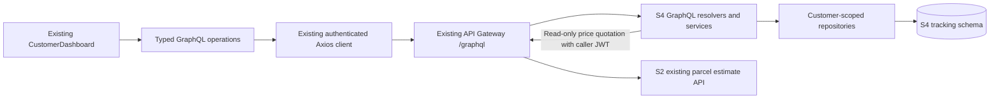

# Customer Dashboard GraphQL integration

## Implemented data flow

The existing CustomerDashboard layout, CSS, cards, icons and responsive grid are retained. Business data
now comes through the existing gateway `/graphql` endpoint and S4's existing GraphQL schema. There is
no mock fallback, new frontend application, microservice, database table or migration.



`customerApi.getDashboard()` delegates to `getDashboardData()` independently of the legacy mock-mode flag.
The latter fetches summary, the first history page and the selected live delivery through three bounded,
typed queries. GraphQL errors, partial responses with errors, missing responses and transport failures are
reported; they never become mock customer data. The existing Axios token interceptor supplies the JWT.
Initial requests and polling are canceled on unmount/account change. Live tracking polls every 30 seconds;
the existing simulation button now refreshes actual GraphQL tracking, with the label “Refresh tracking”.
No fabricated notification is generated from a refresh.

## Feature status

| Feature | Status | GraphQL operation / source |
|---|---|---|
| Active, delivered, awaiting, failed counts | Implemented and connected in source | customerDashboardSummary; customer-scoped status aggregates |
| Monthly spending | Implemented and connected in source | customerDashboardSummary.monthlyFees; actual stored booking fees by currency |
| Live parcel reference/status/cities/weight/size/estimate/events | Implemented and connected in source | customerLiveDelivery; DeliveryDetails extensions and existing event batch resolver |
| Delivery history table | Implemented and connected in source | myDeliveries(page:1,size:4,customerOnly:true); existing View all navigation preserved |
| Tracking search | Implemented and connected in source | publicTracking(trackingRef); only reference/status/public city fields requested |
| Quick estimate | Implemented and connected in source | dashboardFeeEstimate; authorized read-only S2 quotation through gateway |
| Courier profile/contact/status | Existing customer-authorized source unavailable | Existing card displays unavailable and disables the phone link; no invented courier data |
| Notification inbox and persisted read/unread | Existing data model/API insufficient | Existing card explicitly reports unavailable; no fake messages or read-state persistence |
| Authenticated live customer-data verification | Not verified in this implementation run | No authorized customer session was supplied; production data was not modified |

Courier information cannot be safely obtained from the existing dispatcher/courier-only S3 APIs. S4's
courier subject is an authorization identifier, not a courier name or phone directory.
S5 `notification.notification_attempt` stores delivery attempts, without a customer inbox owner/read-state
model or an authorized customer feed API. These capabilities are reported rather than fabricated.

This change covers the dashboard. Other customer pages retain their existing API adapters; it does not
claim to migrate every customer portal page, receipts page or support form to GraphQL.

## Summary rules and repository sources

`CustomerDashboardService.summary(subject)` uses two read-only aggregation queries on
`tracking.tracking_parcel`, always filtered by the validated token subject:

- `customerStatusCounts(subject)`: grouped count by the existing TrackingStatus enum.
- `customerFeeTotals(subject,start,end)`: total and current-month fees grouped by currency.

CREATED means awaiting pickup. Active means CREATED, PICKED_UP, IN_TRANSIT or OUT_FOR_DELIVERY.
In-transit grouping includes PICKED_UP, IN_TRANSIT and OUT_FOR_DELIVERY. DELIVERED and FAILED use their
existing enum values. The capsule shares are calculated from these returned counts, not fixed percentages.

The month is the current calendar month in **Asia/Colombo**, using an injected Clock and the half-open
interval `[first day at local midnight, first day of next month at local midnight)` converted to Instants.
Monthly spending is the sum of stored parcel fees for records created in that month, regardless of status.
It represents booked delivery charges, not verified payment settlements or refunds: there is no payment
ledger in this read model. Currencies are kept separate; different currencies are never added together.
Legacy numeric spending fields are null when no single-currency amount exists; the UI displays the
currency-separated amounts or “No spending recorded”.

`liveParcel(subject)` selects the newest customer-owned active parcel by createdAt, falling back to the
newest owned parcel when no active one exists. An empty account returns null. Existing DTO conversion
is reused by both old and new delivery resolvers. Estimates are derived from stored createdAt plus
estimatedDays; the UI displays a date rather than inventing a precise arrival time.

`myDeliveries` keeps its existing default role behavior. Its new optional `customerOnly:false` argument
is backward compatible. The dashboard sends true, requiring CUSTOMER and using customer-scoped repository
queries even when a token also has DISPATCHER. It never accepts a caller-supplied customer identifier.
Existing `DeliveryDetails.events` batching reads `tracking.tracking_event` with one list-of-references query.

S4 remains the source of its owned read model. If S4 lacks populated customer_subject projection data,
these queries correctly return empty results; they do not query S2's database or invent ownership.
The existing S2 booking event does not populate that identity, and this change does not silently alter
its event contract. Publishers/consumers and read-model population remain deployment prerequisites.

## Schema and operations

The existing schema is extended with:

```graphql
type CurrencyAmount { currency: String!, amount: Float! }
type CustomerDashboardSummary {
  activeCount: Int!
  deliveredCount: Int!
  awaitingPickupCount: Int!
  failedCount: Int!
  inTransitCount: Int!
  totalParcels: Int!
  month: String!
  timeZone: String!
  totalFees: [CurrencyAmount!]!
  monthlyFees: [CurrencyAmount!]!
}
```

`DeliveryDetails` adds nullable `weightKg: Float` and `estimatedDeliveryDate: String`.
Existing public tracking restrictions remain intact; no private fields were added to the public type.
New query fields are:

```graphql
customerDashboardSummary: CustomerDashboardSummary!
customerLiveDelivery: DeliveryDetails
dashboardFeeEstimate(
  pickupCity: String, deliveryCity: String, weightKg: Float!,
  destinationType: String!, parcelCategory: String
): DashboardFeeEstimate!
```

`DashboardFeeEstimate` exposes fee, formattedFee, currency, estimatedDays and a typed breakdown. It does
not calculate prices in S4. `DashboardPricingClient.estimate()` forwards the original caller JWT to the
fixed gateway path `POST /api/v1/parcels/estimate`; that existing S2 endpoint is a read-only quotation.
It uses the Boot-managed RestClient.Builder, bounded timeouts and sanitized failures. S2's existing
business pricing/default-rule behavior is unchanged. The quick card supplies the selected weight,
category and destination class; it no longer invents hidden Colombo/Kandy city values.

Typed frontend operation constants in `dashboardGraphql.ts`:

- `DASHBOARD_SUMMARY_QUERY` → customerDashboardSummary.
- `DASHBOARD_HISTORY_QUERY` → myDeliveries with page/size variables and customerOnly:true.
- `DASHBOARD_LIVE_QUERY` → customerLiveDelivery and its actual events/details.
- `DASHBOARD_TRACK_QUERY` → publicTracking with validated/normalized trackingRef.
- `DASHBOARD_FEE_QUERY` → dashboardFeeEstimate.

Example authenticated read:

```graphql
query {
  customerDashboardSummary {
    activeCount deliveredCount awaitingPickupCount failedCount totalParcels month timeZone
    monthlyFees { currency amount }
  }
  myDeliveries(page: 1, size: 4, customerOnly: true) {
    items { trackingRef status recipient { city } fee currency createdAt deliveredAt }
    pageInfo { page size totalElements totalPages hasNext }
  }
}
```

## Authentication and configuration

Keycloak, API Gateway routing, JWT signature/issuer/audience validation and the existing Axios interceptor
are reused. The new resolver requires authenticated CUSTOMER authority before calling the service.
Summary/live queries derive the subject from the authenticated principal. Existing private delivery
ownership checks, dispatcher-only queries and public tracking field restrictions are preserved.
The frontend never supplies a customer ID and never logs credentials.

S4 calls S2 and S3 directly over gRPC using its own SERVICE client identity. The frontend still reaches S4
through the API Gateway. No credentials are added to frontend requests.
The existing frontend VITE_API_BASE_URL must point at the gateway. No GraphQL proxy/client library or
second authentication mechanism is introduced.

## Files changed for this integration

Backend paths, relative to `backend/tracking-reporting-service/`:

- `src/main/resources/graphql/schema.graphqls`
- `src/main/java/com/zentro/trackingreporting/graphql/config/GraphQlConfig.java`
- `src/main/java/com/zentro/trackingreporting/graphql/dto/DeliveryDetailsDto.java`
- `src/main/java/com/zentro/trackingreporting/graphql/dto/CustomerDashboardSummary.java` (new)
- `src/main/java/com/zentro/trackingreporting/graphql/dto/DashboardFeeEstimate.java` (new)
- `src/main/java/com/zentro/trackingreporting/graphql/endpoint/TrackingGraphQlEndpoint.java`
- `src/main/java/com/zentro/trackingreporting/graphql/endpoint/CustomerDashboardGraphQlEndpoint.java` (new)
- `src/main/java/com/zentro/trackingreporting/graphql/service/CustomerDashboardService.java` (new)
- `src/main/java/com/zentro/trackingreporting/graphql/service/DashboardPricingClient.java` (new)
- `src/main/java/com/zentro/trackingreporting/tracking/repository/TrackingParcelRepository.java`
- `src/main/resources/application.yml` and `.env.example`
- `src/test/java/com/zentro/trackingreporting/graphql/CustomerDashboardRepositoryTest.java` (new)
- `src/test/java/com/zentro/trackingreporting/graphql/CustomerDashboardGraphQlTest.java` (new)
- `src/test/java/com/zentro/trackingreporting/graphql/DashboardPricingClientTest.java` (new)

Frontend paths, relative to `frontend/zentro-web/src/`:

- `shared/api/graphqlClient.ts` (new)
- `portals/customer/services/dashboardGraphql.ts` (new)
- `portals/customer/services/dashboardGraphql.test.ts` (new)
- `portals/customer/services/customerApi.ts`, `types.ts`, `config.ts` (configuration comment only)
- `portals/customer/pages/CustomerDashboard.tsx`
- `portals/customer/pages/__tests__/CustomerDashboard.test.tsx`
- `portals/customer/services/__tests__/customerApi.test.ts`
- `app/router.test.tsx` (explicit GraphQL test fixtures)

Root `docker-compose.yml` sets the S4 gateway URL. This report is new.
Existing uncommitted assistant/gateway work was retained. No GitHub or remote Git operations were used.

## Verification results

| Check | Actual result |
|---|---|
| Targeted backend package/test reactor | 31 tests passed, 0 failures/errors/skips; S4 and gateway jars packaged |
| PostgreSQL repository/service test | Real disposable PostgreSQL 16; tested ownership isolation, empty account, latest-active selection, Colombo month boundary, and separate currencies |
| GraphQL security/schema/resolver tests | Existing read-only/security/batching/limits tests plus new summary, live fields, mixed-role history scope and authenticated quotation resolver tests passed |
| Pricing adapter tests | JWT forwarded only to the fixed gateway quotation path; upstream errors sanitized; no invented city values or price fallback |
| Complete frontend suite | 747 tests passed across 66 files |
| TypeScript | tsc -b --pretty false passed |
| ESLint | Full run: 0 errors, 6 existing warnings; final changed-file lint passed without warnings |
| Production frontend build | Passed; final output /tmp/zentro-dashboard-production-verified; existing large-chunk advisory remains |
| Compose | docker compose config --quiet passed |
| Whitespace check | git diff --check passed |
| Live gateway schema | Initial check found the older schema. After the follow-up local rebuild, HTTP 200 confirms customerDashboardSummary, customerLiveDelivery and dashboardFeeEstimate alongside the existing queries |
| Live authenticated customer records | NOT VERIFIED: no authorized customer session was supplied; no customer records or production test records were created/changed |

Frontend HTTP responses are mocked with MSW; GraphQL resolver tests use isolated test authentication and
mock repositories, while the repository/service test executes real SQL on disposable PostgreSQL.
These tests are not presented as successful live customer-data verification. DOM tests do not establish
pixel-perfect browser rendering; the dashboard CSS/layout classes were retained.

The interrupted broad Maven run was not counted as a successful full backend regression run. The final
31-test package run completed successfully. An initial full frontend run found an old router fixture
assumption and a test-runtime mount limitation; the explicit GraphQL fixture and whole-repository test
mount resolved them, and the final full suite passed.

Reproduce backend checks from repository root:

```bash
mvn -f backend/pom.xml -pl tracking-reporting-service,api-gateway -am package -Dtest='*GraphQl*Test,CustomerDashboardRepositoryTest,DashboardPricingClientTest,GatewayInventoryTests' -Dsurefire.failIfNoSpecifiedTests=false
```

Frontend standard commands in `frontend/zentro-web` are `npm run test`, `npm run type-check`,
`npm run lint`, and `npm run build`. This environment has no host npm; checks used Node 22 in Docker.
The full suite mounted the repository because the courier API boundary test reads the gateway YAML.
The production build used a temporary directory because existing dist files were not writable.

## Using the updated application

The initial implementation did not replace running containers. A subsequent local deployment refreshed
S4 and the frontend after the old dashboard was reported. To repeat that rebuild using existing local
environment files and infrastructure, run from repository root:

```bash
docker compose up -d --build --no-deps tracking-reporting-service zentro-web
```

The existing gateway `/graphql` route is reused; no gateway route change is needed for these new fields.
Sign in through the existing customer login. Verify the Network panel shows authenticated `/graphql`
queries and compare their returned values with the displayed summary, history and tracking fields.
An account with no S4-owned records should see the existing empty state, not seeded mock parcels.
A backend outage should display the existing error/retry state. Do not paste JWTs or credentials into chat.
No production database records need to be created to perform those read checks.

## Follow-up: old mock dashboard deployment corrected

The browser URL was confirmed as `http://localhost`, served by Docker. The running frontend and S4
were rebuilt and recreated with the command above. Verification after startup confirmed:

- HTTP 200 from localhost and the rebuilt `/assets/index-D335gqCg.js` bundle.
- The served bundle contains the dashboard GraphQL operations.
- Gateway introspection returns all seven query fields, including the three new dashboard operations.

Existing open browser tabs need a hard refresh to load the new JavaScript. No customer records were
queried during these checks, so authenticated customer-data verification remains distinct and outstanding.
No unrelated or orphan containers were removed.
