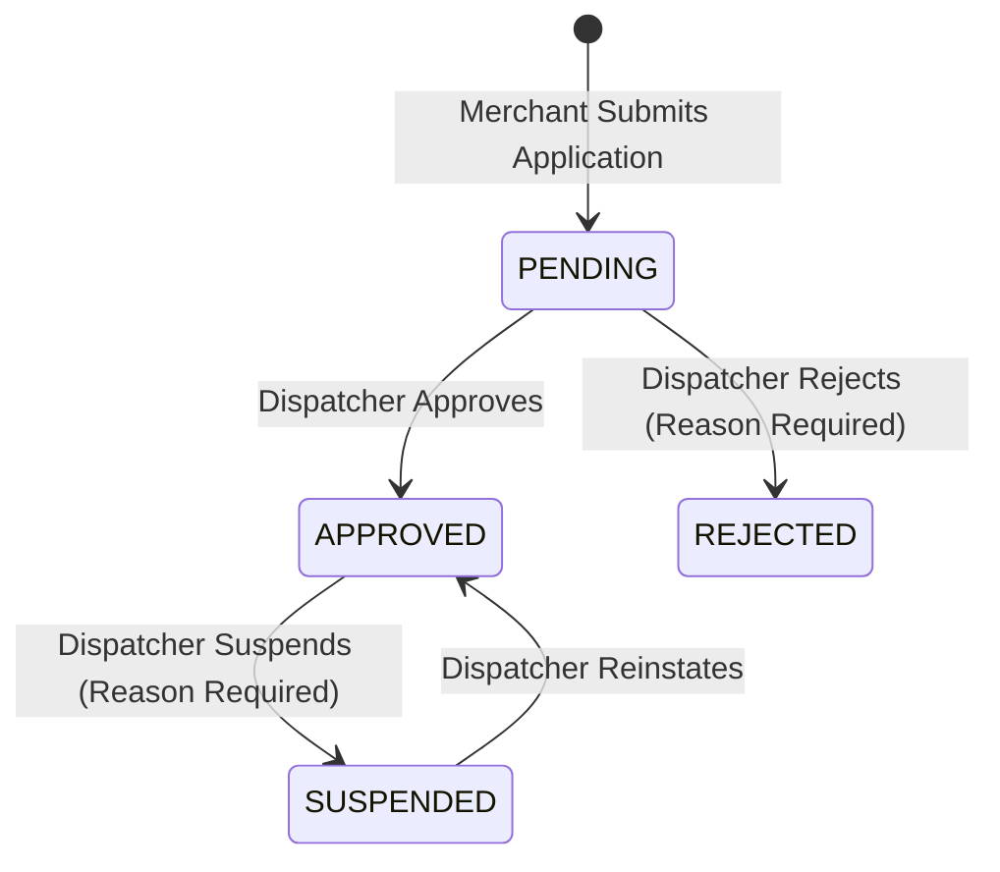
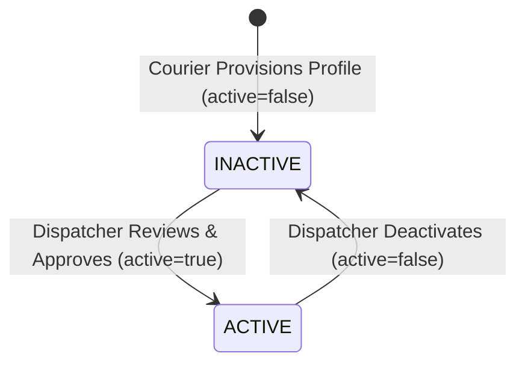

# Dispatcher Partner Approval Workflow (ZD-083)

## Overview
The SwiftDrop Dispatcher Partner Approval Screen (`/dispatcher/merchant-approvals` and `/dispatcher/partner-approvals`) provides operational oversight and administrative review for:
1. **Merchant Applications**: Business profile registration, commercial identification, and account approval.
2. **Courier Fleet Profiles**: Courier registration, vehicle category, delivery zone assignment, and active operational eligibility.

Administrative responsibilities belong exclusively to the `DISPATCHER` role. There is no separate `ADMIN` user role.

---

## 1. Backend Service & API Contracts

All partner review endpoints are hosted on **S1 Identity & Partner Service (`identity-partner-service`)** and protected by Spring Security (`@PreAuthorize("hasRole('DISPATCHER')")`) and the API Gateway (`RoleAuthorizationManager.has("ROLE_DISPATCHER")`).

### Merchant Application Review Endpoints
| Method | Path | Description | Required Role |
| :--- | :--- | :--- | :--- |
| `GET` | `/api/v1/admin/merchants?status={status}` | List applications (PENDING, APPROVED, REJECTED, SUSPENDED) | `DISPATCHER` |
| `PATCH` | `/api/v1/admin/merchants/{id}` | Approve or reject application (requires `decision` and optional `rejectionReason`) | `DISPATCHER` |
| `PATCH` | `/api/v1/admin/merchants/{id}/suspend` | Suspend an approved merchant (requires non-blank `reason`) | `DISPATCHER` |
| `PATCH` | `/api/v1/admin/merchants/{id}/reinstate` | Reinstate a suspended merchant to approved status | `DISPATCHER` |
| `GET` | `/api/v1/admin/merchants/{id}/api-key` | View merchant API key metadata | `DISPATCHER` |
| `DELETE` | `/api/v1/admin/merchants/{id}/api-key` | Revoke merchant API key | `DISPATCHER` |

### Courier Eligibility & Profile Endpoints
| Method | Path | Description | Required Role |
| :--- | :--- | :--- | :--- |
| `GET` | `/api/v1/admin/couriers?active={active}&zone={zone}&search={search}` | List registered couriers | `DISPATCHER` |
| `GET` | `/api/v1/admin/couriers/{courierId}` | Inspect full courier profile details | `DISPATCHER` |
| `PATCH` | `/api/v1/admin/couriers/{courierId}` | Update courier profile and toggle `active` eligibility | `DISPATCHER` |

---

## 2. Review Lifecycles

### Merchant Lifecycle

### Courier Operational Eligibility Lifecycle

---

## 3. UI Features & Security Controls

- **Partner Type Filtering**: Dedicated tabs for `Merchants`, `Couriers`, and `All Partners`.
- **Status Filtering**: Filter by `ALL`, `PENDING`, `APPROVED`, `REJECTED`, or `SUSPENDED`.
- **Search Filtering**: Filter across business names, courier names, phone numbers, registration numbers, and assigned zones.
- **Application Details Modal**: Inspect full applicant verification data (App User UUID, business registration number, vehicle type, timestamps, reviewer notes).
- **Form Validation**: Strict validation requiring a rejection reason before rejecting a merchant application.
- **Duplicate Submission Prevention**: Action buttons enter a pending/disabled state while mutations are in-flight.
- **Role Verification**: Non-dispatcher users cannot view or trigger administrative mutations; 403 Forbidden responses display user-friendly permission error notices.
